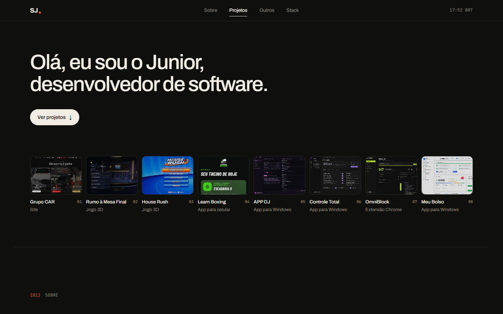
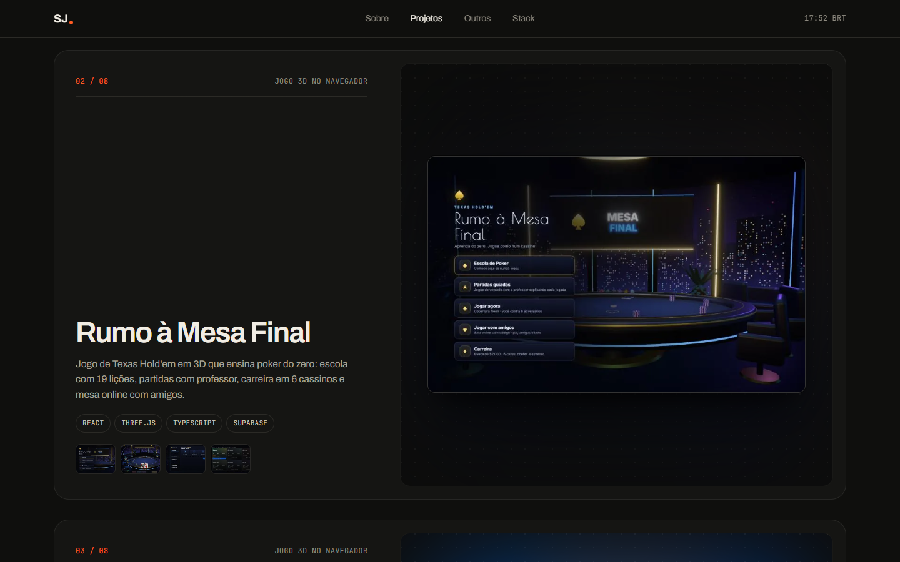
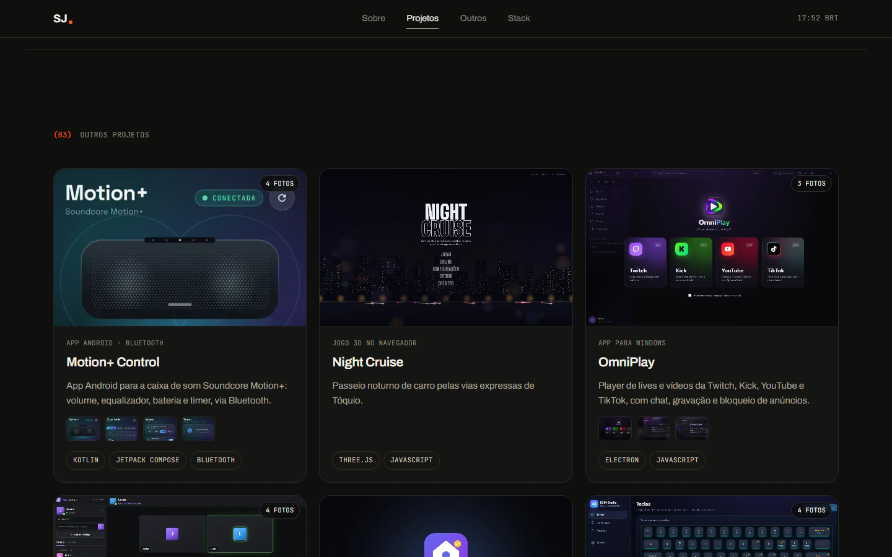
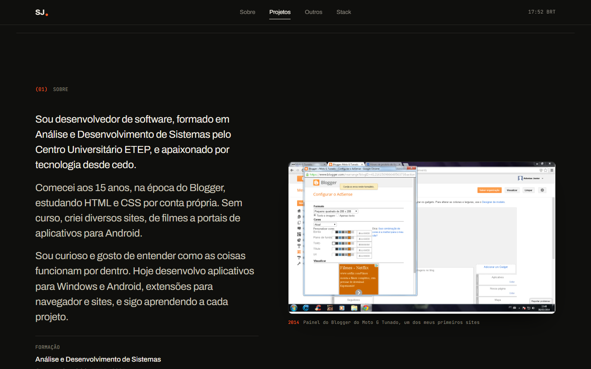
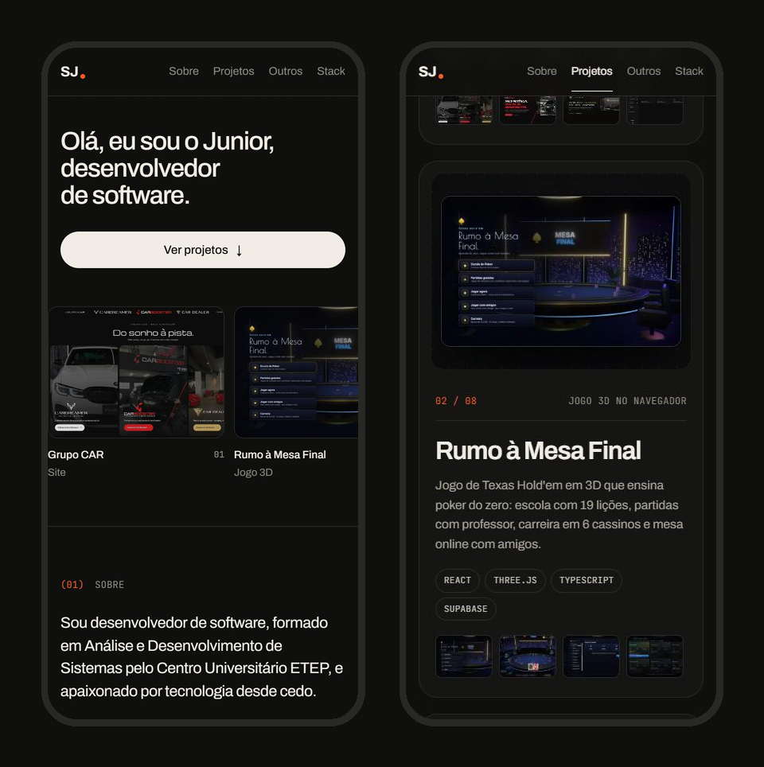

# Portfólio · Junior

Site de apresentação com os meus projetos: apps para Windows e Android, extensões para o Chrome, jogos e sites.

**🔗 Acesse: [souapenasjunior.vercel.app](https://souapenasjunior.vercel.app)**



## Telas

**Projetos em destaque:** cada projeto aparece dentro de uma janela, navegador ou celular, com uma fileira de fotos que abre uma galeria em tela cheia.



**Outros projetos:** grade com o restante dos projetos, cada um com fotos e as tecnologias usadas.



**Sobre**



**No celular:** funciona em iPhone e Android, respeitando o notch e a barra de baixo do iPhone.



## O que tem no site

- Projetos em destaque e grade com os demais, todos com galeria de fotos (setas, teclado e deslizar no celular)
- Prints apresentados em molduras de janela, navegador e celular, com a luz de fundo tirada das cores do próprio print
- Leve inclinação 3D dos prints ao passar o mouse
- Layout adaptado para celular, tablet e computador
- Sem frameworks e sem etapa de build: HTML, CSS e JavaScript puros

## Tecnologias

HTML · CSS · JavaScript · Google Fonts (Archivo, Instrument Serif e JetBrains Mono) · Vercel

## Rodar no computador

Não precisa instalar nada. Basta abrir o `index.html` no navegador ou, para testar como um site:

```bash
python -m http.server 8000
```

E abrir `http://localhost:8000`.

## Estrutura

```
index.html   página
style.css    visual
script.js    galeria, inclinação 3D, menu e relógio
img/         prints dos projetos (img/g = galerias, img/g/t = miniaturas)
docs/        imagens deste README
```

---

Feito por **Junior** · [@souapenasjunior](https://github.com/souapenasjunior)
